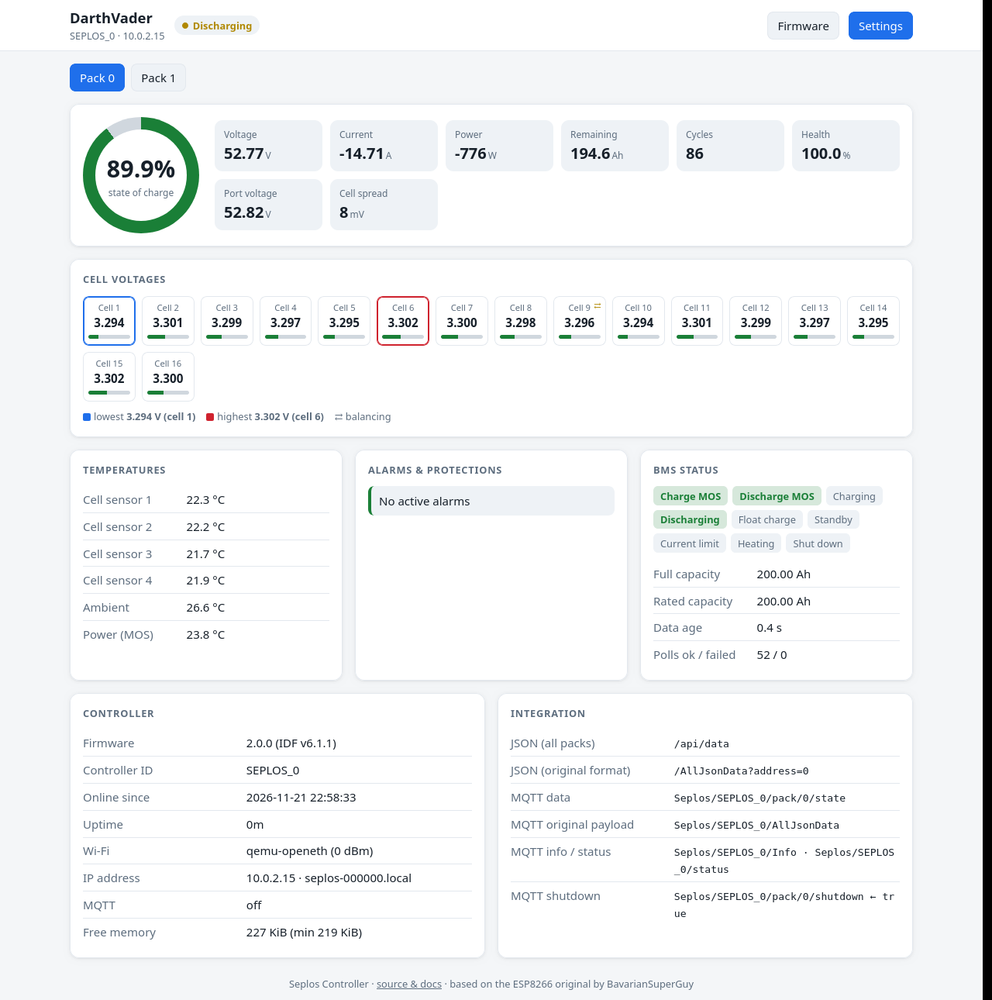
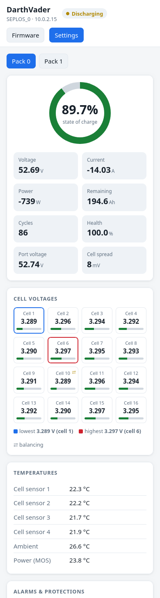
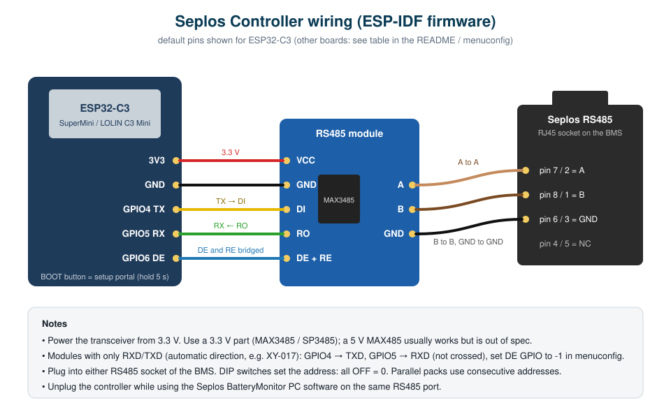

# ESP Seplos Controller

Monitor (and if needed switch off) a **Seplos BMS** over RS485 from an ESP32: live web dashboard,
JSON API, MQTT with Home Assistant auto-discovery, alarms, several packs on one bus and
firmware updates over Wi-Fi.

This is an open-source **ESP-IDF v6.1** rewrite of the closed-source ESP8266 firmware
v1.0.1.2 by *BavarianSuperGuy* that this repository used to ship as a binary only. The original
was reverse engineered ([docs/reverse-engineering.md](docs/reverse-engineering.md)) and its
HTTP endpoints, MQTT topics and JSON payloads are kept, so existing Grafana / Node-RED / Home
Assistant setups keep working.

<p align="center">
  
  
</p>

## Contents

- [What is new compared to the ESP8266 firmware](#what-is-new-compared-to-the-esp8266-firmware)
- [Hardware](#hardware)
- [Build and flash](#build-and-flash)
- [First-time setup](#first-time-setup)
- [HTTP API](#http-api)
- [MQTT and Home Assistant](#mqtt-and-home-assistant)
- [Testing without hardware](#testing-without-hardware)
- [Repository layout](#repository-layout)
- [Credits, license, disclaimer](#credits-license-disclaimer)

## What is new compared to the ESP8266 firmware

| | ESP8266 v1.0.1.2 (binary only) | This firmware |
|---|---|---|
| Source code | not published | full source, ESP-IDF v6.1.1 |
| Chip | ESP8266 (no longer supported by ESP-IDF) | ESP32-C3, ESP32, ESP32-S3 |
| Packs | address 0 only | up to 16 packs (consecutive DIP addresses) |
| Alarms / warnings | missing | decoded (0x44): protections, warnings, balancing, MOS state |
| Cell count | temperatures decoded wrong unless exactly 16 cells | any cell / sensor count |
| Frame checks | length checksum, CRC | + actual length, BMS return code, pack address, echo filtering |
| MQTT | AsyncMqttClient "stops sending after a while" (original README) | esp-mqtt with bounded outbox, LWT `status`, TLS (`mqtts://`) |
| Home Assistant | – | MQTT auto-discovery: SOC, V, A, W, cells, temperatures, alarms |
| Shutdown | plain `GET /ShutDown` (a link prefetcher can switch off your battery) | `POST` + typed confirmation, per pack, MQTT switch can be disabled |
| Security | none | optional admin password (HTTP Basic) for settings, OTA, restart, shutdown |
| Firmware update | ElegantOTA, no rollback | dual OTA slots, automatic rollback if the new image does not start |
| Setup | WiFiManager portal, double-reset | captive portal with Wi-Fi scan; BOOT button, double-reset, or automatic fallback AP after 3 min without Wi-Fi |
| Web UI | German, polling the whole page every 500 ms | English, responsive, dark mode, works offline in setup mode |
| Tests | – | host unit tests + fuzzing, BMS simulator, QEMU end-to-end test, CI |

Bugs found in the original binary are listed in
[docs/reverse-engineering.md](docs/reverse-engineering.md#bugs-and-limitations-found-in-the-original).

## Hardware

You need an ESP32 board, a 3.3 V RS485 transceiver module and a network cable to one of the
two RS485 RJ45 sockets of the BMS.

<p align="center"></p>

Default pins (change them with `idf.py menuconfig` → *Seplos Controller*):

| Board | TX → DI | RX ← RO | DE + RE | Setup button | Status LED |
|---|---|---|---|---|---|
| ESP32-C3 (e.g. SuperMini) | GPIO4 | GPIO5 | GPIO6 | GPIO9 (BOOT) | GPIO8 (active low) |
| ESP32 (DevKitC, D1 mini ESP32) | GPIO17 | GPIO16 | GPIO4 | GPIO0 (BOOT) | GPIO2 |
| ESP32-S3 (DevKitC) | GPIO17 | GPIO18 | GPIO8 | GPIO0 (BOOT) | – |

* **MAX485 / MAX3485 module** (`RO RE DE DI` pins, [photo](docs/images/rs485-module-max485.png)):
  bridge DE and RE and connect them to the DE GPIO. The UART switches the direction
  automatically (ESP-IDF RS485 half-duplex mode).
* **Auto-direction module** with only `RXD TXD` pins (XY-017, [photo](docs/images/rs485-module-xy017.png)):
  ESP TX → module TXD, ESP RX → module RXD (**not crossed**), set *RS485 DE/RE GPIO* to `-1`.
* Power the transceiver from **3.3 V**.
* Seplos RJ45: pins **1/8 = B**, **2/7 = A**, **3/6 = GND**. Connect A to A and B to B.
* BMS address = DIP switches; all OFF = address 0. For parallel packs set *First pack address*
  and *Number of packs* in the web settings.
* Unplug the controller while you use the Seplos BatteryMonitor PC software on the same port.

Coming from the ESP8266 build? The original wiring plans are in
[docs/legacy-esp8266.md](docs/legacy-esp8266.md) (translated to English). Only the ESP side
changes: use the GPIOs from the table above instead of TX/RX/GPIO0.

## Build and flash

The firmware lives in [`firmware/`](firmware). It needs **ESP-IDF v6.1** (tested with v6.1.1);
MQTT and mDNS come from the ESP component registry and are pinned in `firmware/dependencies.lock`.

With a local ESP-IDF installation:

```sh
cd firmware
idf.py set-target esp32c3        # or esp32 / esp32s3
idf.py menuconfig                # optional: pins, baud rate, AP password
idf.py -p /dev/ttyACM0 flash monitor
```

With Docker only:

```sh
docker run --rm -v "$PWD:/project" -w /project/firmware espressif/idf:v6.1.1 \
  sh -c "idf.py set-target esp32c3 && idf.py build"
cd firmware/build && esptool --chip esp32c3 -p /dev/ttyACM0 write-flash @flash_args
```

Ready-made images are attached to GitHub releases (built by CI):
`seplos-controller-<chip>-full.bin` is flashed once at address `0x0` (for example with
`esptool --chip esp32c3 write-flash 0x0 seplos-controller-esp32c3-full.bin` or the browser-based
[ESP Tool](https://espressif.github.io/esptool-js/)), and `seplos-controller-<chip>-ota.bin`
is uploaded later through *Firmware* in the web UI.

## First-time setup

1. Power the controller. Without stored Wi-Fi it opens the access point **`SEPLOS_<id>`**,
   password **`12345678`** (change it with `menuconfig`).
2. Join it with a phone or laptop. The setup page opens by itself (captive portal), or browse to
   <http://192.168.4.1/>.
3. **Settings** → *Scan* → choose your network, enter the password, optionally the MQTT broker
   (`mqtt://192.168.1.10:1883`), and *Save*. The controller restarts and joins your network.
4. Open `http://seplos-xxxxxx.local/` (mDNS) or the IP address your router shows.

Back into setup mode later: hold the **BOOT button for 5 s**, press **reset twice within 10 s**
(as with the original firmware), or use *Settings → Restart into setup*. If the saved network is
unreachable for 3 minutes the setup access point also starts automatically, while the controller
keeps retrying the network. A setup mode started by the button or a double reset ends by itself
after 5 minutes without anyone connected (so two quick power blips cannot leave an unattended
controller offline).

Status LED: fast blink = setup mode, slow blink = no network, double flash = BMS not
answering, short flash every 2 s = everything OK.

## HTTP API

| Method + path | Description |
|---|---|
| `GET /api/data` | Device info + all packs (JSON, see below) |
| `GET /api/config` · `POST /api/config` | Settings (form-encoded POST; secrets are never returned) |
| `GET /api/scan` | Wi-Fi scan |
| `POST /api/restart` | Restart (`portal=1`: into setup mode) |
| `POST /api/shutdown` | `address=<n>&confirm=SHUTDOWN` switches that BMS off |
| `POST /api/ota` | Raw `.bin` body, installs into the other OTA slot and restarts |
| `GET /AllJsonData[?address=n]` | **Original** JSON format (same keys and decimals as v1.0.1.2) |
| `GET /dataonce` | **Original** static info JSON |
| `GET /System?BatName=…` | **Original** "save battery name" call |
| `GET /ShutDown` | **Original** shutdown, disabled unless `CONFIG_SEPLOS_LEGACY_GET_SHUTDOWN=y` |

If an admin password is set, everything that changes state (and `GET /api/config`, `/api/scan`)
requires HTTP Basic auth with user `admin`. Read-only data stays public.

Example pack object from `/api/data` (abridged):

```json
{"address":0,"online":true,"age_ms":412,"soc":97.3,"soh":100.0,"voltage":53.41,"current":-1.87,
 "power":-99.9,"remaining_ah":194.61,"capacity_ah":200.00,"cycles":86,"port_voltage":53.46,
 "cells":[3.336,3.335,...],"cell_min_v":3.333,"cell_min_index":6,"cell_max_v":3.341,"cell_max_index":5,
 "cell_diff_mv":8,"temps":{"cells":[22.3,22.2,21.7,21.9],"ambient":26.6,"power":23.8},
 "status":{"discharging":true,"charge_switch":true,"discharge_switch":true,...},
 "balancing":[6],"alarms":[{"text":"Cell high voltage alarm","protection":false}],"alarm_count":1}
```

## MQTT and Home Assistant

Base topic default: `Seplos/<controller id>` (same as the original firmware).

| Topic | Direction | Payload |
|---|---|---|
| `<base>/status` | publish, retained | `online` / `offline` (last will) |
| `<base>/Info` | publish | text messages (ready, pack online/offline, shutdown results) |
| `<base>/AllJsonData` | publish every poll | **original** JSON of the first pack |
| `<base>/pack/<addr>/state` | publish every poll | per-pack JSON as in `/api/data` |
| `<base>/ShutDown` | subscribe | `true` / `1` / `on` → shut down the first pack (**original** topic) |
| `<base>/pack/<addr>/shutdown` | subscribe | `true` / `1` / `on` → shut down that pack |

With *Home Assistant auto-discovery* enabled (default) each pack appears as a device with SOC,
SOH, voltage, current, power, capacities, cycles, min/max/spread, every cell voltage, every
temperature and the number of active alarms. Remote shutdown can be switched off in the
settings; it is never exposed to Home Assistant as a button.

## Testing without hardware

```sh
test/host/run_tests.sh       # protocol + JSON unit tests (ASan/UBSan, 250k fuzz iterations)
test/qemu/run_e2e.sh         # firmware in QEMU + BMS simulator + Mosquitto: 45 end-to-end checks
test/qemu/run_demo.sh        # firmware in QEMU with a simulated 2-pack battery: http://127.0.0.1:18080/
```

The QEMU scripts need the QEMU build (`esp32` with emulated Ethernet instead of Wi-Fi):

```sh
cd firmware
idf.py -B build-qemu -D SDKCONFIG=build-qemu/sdkconfig \
       -D SDKCONFIG_DEFAULTS="sdkconfig.defaults;sdkconfig.qemu" set-target esp32 build
```

`tools/bms_simulator.py --serial /dev/ttyUSB0` also emulates a BMS on a real RS485 adapter, which
is handy to test a controller on the bench.

## Repository layout

```
firmware/                ESP-IDF project
  components/seplos/     protocol V2.0 codec + JSON rendering (pure C, unit tested on the host)
  main/                  RS485 polling, Wi-Fi/portal, web server, MQTT, settings, OTA
  main/www/index.html    web UI (gzipped into the firmware at build time)
test/host/               unit tests        test/qemu/   end-to-end tests and demo
tools/                   BMS simulator, reference frame encoder, reverse-engineering scripts (tools/re)
docs/                    protocol, reverse-engineering notes, legacy ESP8266 docs, images
legacy/esp8266/          original v1.0.1.2 binary and Windows flashing tools (unchanged)
```

## Credits, license, disclaimer

The original ESP8266 firmware, web page and wiring plans are by Klaus Lichtnecker
(*BavarianSuperGuy*, [YouTube](https://www.youtube.com/c/BavarianSuperGuy)), published under the
MIT license in [KlausLi/Esp-Seplos-Controller](https://github.com/KlausLi/Esp-Seplos-Controller).
His original README is preserved in [German](docs/README.de.md) and
[English](docs/legacy-esp8266.md). This rewrite is MIT licensed as well, see [LICENSE](LICENSE).

No liability is accepted for damage caused by using this software or hardware. Working on battery
systems is at your own risk.
