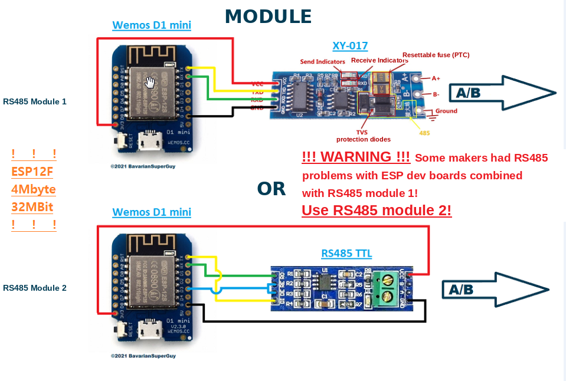
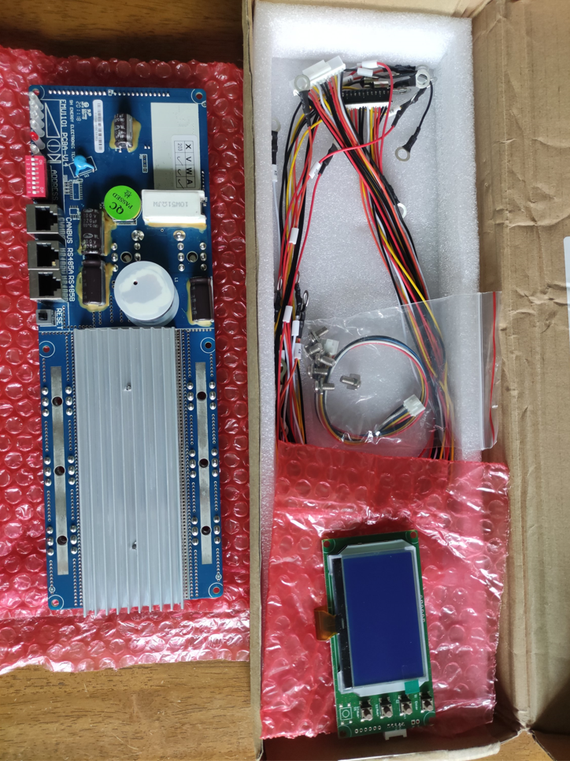
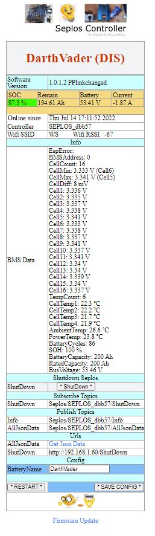
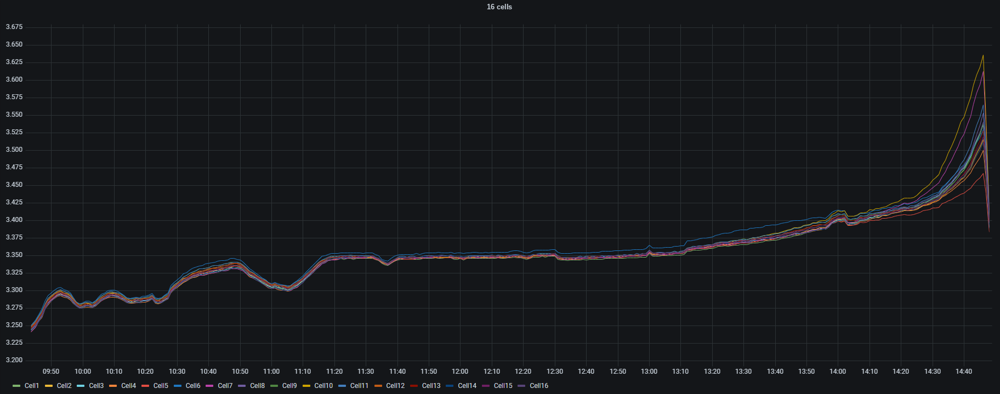
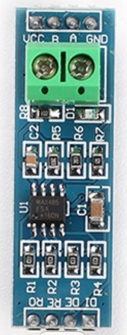
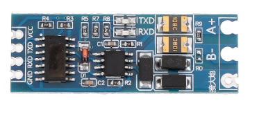
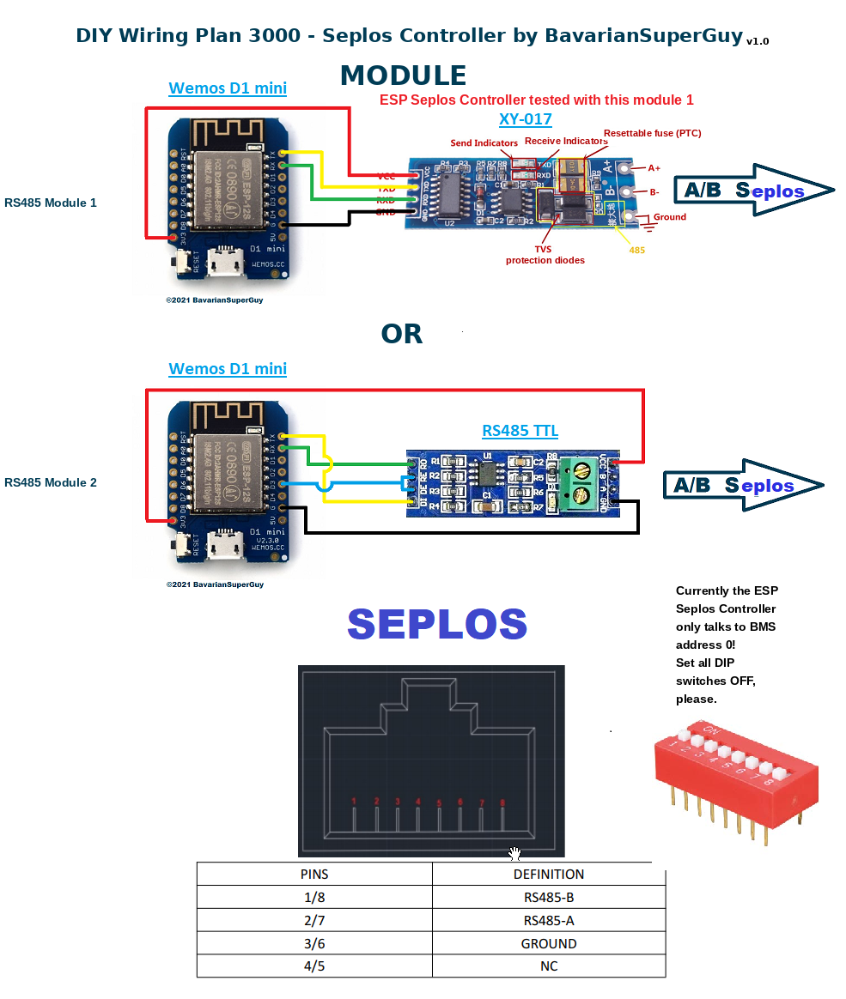

# Legacy ESP8266 firmware v1.0.1.2 (English translation)

This is an English translation of the original German README by *BavarianSuperGuy*, kept for
people who still run the ESP8266 binary in [`legacy/esp8266/espflasher`](../legacy/esp8266/espflasher).
The German original is in [README.de.md](README.de.md); the German versions of the images are in
[images/de](images/de). For new builds use the ESP-IDF firmware described in the
[main README](../README.md).

---

Currently the MQTT publish every second is a bit buggy (after a while nothing is sent any more).
It is better to use the HTTP interface at the moment. Update coming soon.

It would be nice if you didn't forget to subscribe to and like my channel ;-) ... and if
disliking is good, that too :-))

https://www.youtube.com/c/BavarianSuperGuy

If you want to support me, donations are very welcome and would make me very happy :-)
Here, please: https://paypal.me/BSGuy

- ESP-Seplos-Controller https://youtube.com/shorts/0HGCiqtWsLY
- ESP-Seplos-Controller https://youtube.com/shorts/t7gg1kQGDu8
- DIY battery with "Die Wilde Hilde" https://youtu.be/PTiBvcVJqQ0
- Unpacking the Seplos "Die Wilde Hilde" https://youtu.be/xBSRQ2GIqGY

I accept no liability for damage that is or was caused by using the software.
Everyone is responsible for what they do. I am not aware of any problems.

THE WIRING DIAGRAM IS AT THE VERY BOTTOM (Bastelplan3000 = "DIY wiring plan 3000")

Three things are important for this project:
- 3.3 V
- Good Wi-Fi reception (no spaces in the router's SSID)
- Read the README completely, then read it again

If, after reading the README, you notice that your Wi-Fi reception is bad and cannot be improved,
see https://www.google.com/search?q=esp8266+antennenhack (ESP8266 antenna hack).
I cannot program better reception! And the ESP cannot do anything else while it keeps trying to
log in to the Wi-Fi.

Internet Explorer is not supported (it does its own thing with the slider function).

## Seplos Controller with web page

The ESP8266 is connected to the Seplos BMS through an RS485 module and reads its data
(protocol V2.0).
Shutdown button: the BMS is switched off, the same way as holding the push button on the BMS.

The BMS is connected to one of its two RS485 sockets. Normally the battery monitor is connected
there through an RS485 adapter; now the ESP is connected instead for monitoring.
The second RS485 socket is for connecting more Seplos BMSs; I believe up to 15 can be combined.
The DIP switches do not need to be changed for a single BMS: all OFF!
The inverters go on the CAN bus. If someone has such a talkative device, the inverter can also
switch off the BMS (but that has nothing to do with this software).

In short: the firmware available here reads the BMS, and the BMS can be switched off with a
button click. The warnings are still missing.
Note: when using the Seplos battery monitor software on the RS485 port, unplug the ESP from the BMS!

The firmware (`firmware_vX.X.X.X.bin`) is in the `espflasher` directory.
It can easily be flashed onto a 4 MB ESP with the included tool `FlashESP8266.exe`.
`FlashESP8266.exe` is not mine, but it has served very well.

13.02.2022: Darth Vader pack FULLY charged. Cell 6 tamed with the lamp balancer, and this time
cells 10 and 7 ran away.
- 5639 Wh were charged from the sun

What the ESP8266 Seplos Controller can do:

- MQTT interface. The payload is a JSON object; the topic addresses are shown in the ESP web UI
  and are unique for every ESP.
- HTTP interface, data is returned as JSON.
- The SAVE CONFIG button is reserved for future functions.
- Currently only one BMS can be read; multi-pack reading ... coming soon.
- The SOC row blinks when the BMS is charging or discharging; with current == 0 the row stays
  white and does not blink.
- The SOC column is coloured like in the battery monitor: 0-30 % red, 30-50 % yellow, 50-100 % green.
- The ESP heartbeat gets "DIS" appended when the battery is delivering power.
- The transmitted data is safe: length and CRC are checked.

For those who want to know exactly: Serial1 is the debug serial port, on GPIO2 (115200 baud).
The frame received from the BMS is also printed there.

To shut down via MQTT, send the payload `true`.
At the moment the ESP Seplos Controller only communicates with address 0! Set all DIP switches OFF, please.

## RS485-TTL adapters (two different ones tested)

Connect adapter A to A of the Seplos and B to B.

- "DI DE RE RO" RS485 module: bridge the middle pins DE and RE and connect them to ESP GPIO0.
  Then RS485 DI to ESP TX and RS485 RO to ESP RX.

- "RX TX" RS485 module: connect RS485 TX to ESP TX and RS485 RX to ESP RX, i.e. do **not** cross them!

Vcc is 3.3 V for both modules!

Do not use a USB-TTL adapter as the permanent 3.3 V supply; for the first flashing it is OK.

## Setup

- 0. When using MQTT: open the MQTT.fx client, connect to the broker and subscribe to `Seplos/#`.
- 0.1 After step 8 the ESP publishes an info message with its IP address.
- 0.2 You can of course also find the IP address the usual way.
- 1. Flash the firmware onto the erased ESP8266.
- 2. Restart the ESP.
- 3. Look for the Wi-Fi network `SEPLOS_...`.
- 4. Connect with the password `12345678`.
- 5. A browser window with 192.168.4.1 opens automatically.
- 6. Under *Configuration*:
- 6.1 Select or type the Wi-Fi network and enter its password.
- 6.2 MQTT currently works only without SSL; user/password are supported since v1.0.1.1.
- 7. Save with the button at the very bottom.
- 8. Restart the ESP.
- 9. Find the IP address in the MQTT client or in the router.

## Commissioning

- 1. Open the IP address in the browser.

## Config portal

To get back into the config portal later to change the Wi-Fi and MQTT settings:
- tap the ESP's RST pin to GND twice within 10 seconds,
- for example by pressing a push button twice in a row.

The ESP then restarts into the config portal (setup step 3). Enter all settings again, including
the missing ones, and click *Save* (button at the very bottom).

## DIY wiring plan 3000

The Bastelplan3000 mod fits 100 %.
Mentioned up front: on the RS485 cable to the BMS, the first two wires are A and B:
brown-white = A, brown = B.

Connection: A to A and B to B. Tested with RS485 module 1.

